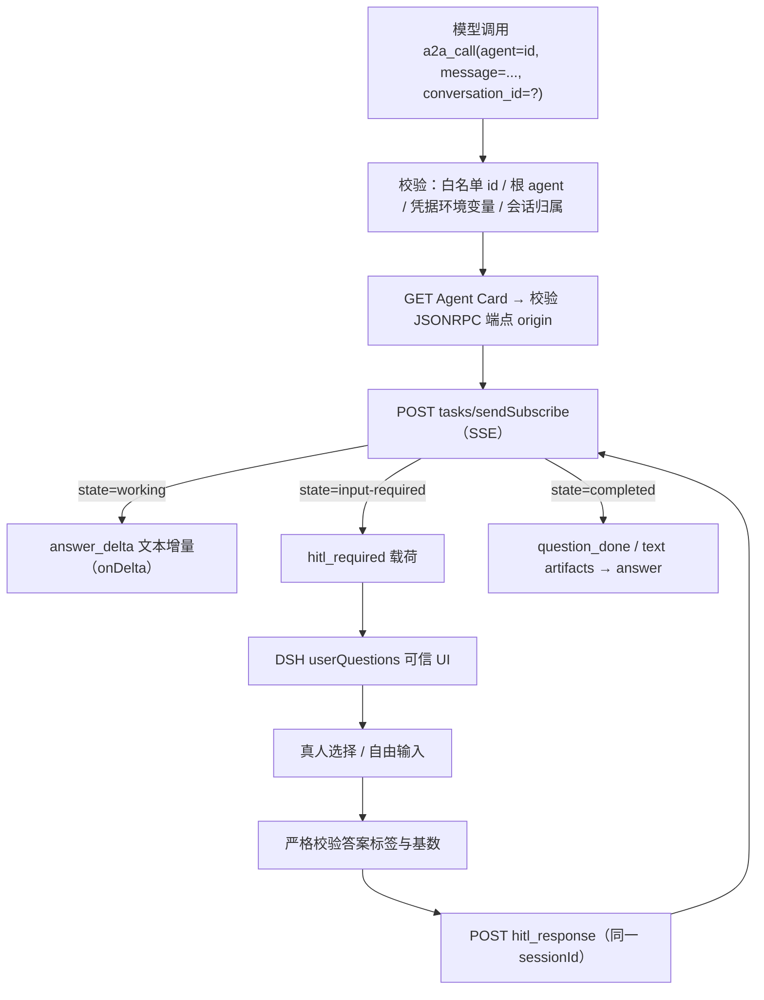

<h1 align="center">
  <br>
  dsh-a2a-hitl
  <br>
</h1>

<p align="center">
  <strong>让 DeepSeek Harness 安全地调用外部 A2A 智能体，并把人工确认交回真人。</strong><br>
  <sub>A2A SSE client + trusted Human-in-the-loop relay, packaged as a reusable DSH plugin.</sub>
</p>

<p align="center">
  <a href="https://github.com/ninetyhe-90/dsh-a2a-hitl/releases"></a>
  <a href="package.json"></a>
  <a href="package.json"></a>
  <a href="test"></a>
  <a href="#-license"></a>
</p>

<p align="center">
  <a href="#-快速开始">🚀 快速开始</a> •
  <a href="#-在-dsh-中启用">🔌 在 DSH 中启用</a> •
  <a href="#-配置">⚙️ 配置</a> •
  <a href="#-给模型暴露的工具">🛠 工具</a> •
  <a href="#-一次调用发生了什么">🔁 调用流程</a> •
  <a href="#-安全边界">🔒 安全边界</a> •
  <a href="#-直接使用客户端">🧩 独立客户端</a> •
  <a href="#-开发与验证">🧪 开发</a>
</p>

<p align="center">
  <sub>装好之后，模型多出 <code>a2a_list_agents</code> 和 <code>a2a_call</code> 两个工具；远端要求人工确认时，弹窗来自 DSH 原生 <code>userQuestions</code>，模型无法代替用户作答。</sub>
</p>

---

## ✨ 这是什么

`dsh-a2a-hitl` 把「调用外部 A2A 智能体」收进一个受控通道：外部智能体由管理员在配置里白名单登记，模型只能按 `id` 调用，不能传 URL；远端在任务中途要求人工确认时，请求被翻译成 DSH 原生的用户提问，由真人作答后再回传给远端，模型全程无法伪造、替换或跳过这个回答。

| 能力 | 说明 |
| --- | --- |
| 白名单式调用 | 只有 `agents` 中登记的 `id` 可被模型调用，`a2a_call` 不接受 URL |
| Agent Card 发现 | 从 `cardUrl` 读取 `supportedInterfaces` 中的 JSONRPC 端点，并校验其 origin |
| SSE 流式读取 | `tasks/sendSubscribe`，支持 `answer_delta` 增量文本与分块到达的帧 |
| 可信 HITL 中继 | `input-required` 的 `hitl_required` 转成 DSH `userQuestions`，答案严格校验后回传 |
| 会话句柄 | `conversation_id` 绑定本地会话、agent 与凭据，带 TTL、容量上限和忙锁 |
| 网络与凭据防护 | 强制 HTTPS、拒绝私网/保留地址、禁止重定向、凭据只从环境变量取 |

**它不做什么：** 不执行远端要求调用的本地工具（`action_type: client_tool` 一律拒绝）、不自动重试失败请求、不自动批准任何确认、不把远端的最终回复当作本地操作授权、不提供 A2A 服务端实现（本项目是客户端/插件）。

| 项目 | 值 |
| --- | --- |
| 运行环境 | Node >= 22.18.0 |
| 兼容 DSH | `^0.2.1-rc.5` 或 `^0.2.2-rc.2` |
| 关键依赖 | `@deepseek-ai/cordis ~4.1.0`、`dsh-agent`、`dsh-tools`、`dsh-user-questions` |
| 模块形式 | ESM，导出 `.`（插件入口）与 `./client`（独立客户端） |
| 当前状态 | `npm run check` 通过：typecheck + 41 个测试 + build |
| 分发方式 | GitHub Release 预构建 tarball；尚未发布到 npm |
| License | UNLICENSED，见 [License](#-license) |

---

## 🚀 快速开始

前置条件：Node >= 22.18.0。

```bash
git clone https://github.com/ninetyhe-90/dsh-a2a-hitl.git
cd dsh-a2a-hitl
npm ci --include=dev
npm run check        # typecheck + 41 个测试 + build，产出 dist/
```

从 Release 安装预构建包（已包含 `dist/`，无需本地构建）：

```bash
dsh plugin --profile <name> add https://github.com/ninetyhe-90/dsh-a2a-hitl/releases/download/v0.1.0/dsh-a2a-hitl-0.1.0.tgz
```

或直接从 GitHub 源码安装（会执行 `prepare` 构建）：

```bash
dsh plugin --profile <name> add github:ninetyhe-90/dsh-a2a-hitl
```

自己打包分发：

```bash
npm pack             # prepack 自动跑 check，产出 dsh-a2a-hitl-0.1.0.tgz
npm install ./dsh-a2a-hitl-0.1.0.tgz
```

三种使用方式：

| 方式 | 适用 | 入口 |
| --- | --- | --- |
| DSH 插件（主用法） | 让模型拥有 A2A 工具 | 包根 `apply`，见[在 DSH 中启用](#-在-dsh-中启用) |
| 独立客户端 | 自己的 Node 程序里直接调 | `dsh-a2a-hitl/client`，见[直接使用客户端](#-直接使用客户端) |
| 本地验证 | 不起 DSH，跑通完整链路 | `npm test`，见 `test/runtime.test.ts` |

`test/runtime.test.ts` 会起一个本地假 A2A 服务，并加载真实的 Cordis / DSH `tools` 与 `userQuestions` 服务，跑两个并发 owner 的完整确认链路（含跨 owner 句柄隔离断言）；这是理解运行时行为最快的入口。

---

## 🔌 在 DSH 中启用

包内 `package.json` 通过 `dsh.bundle.patch` 指向 `cordis.patch.yml`，内容是把插件行插进 profile：

```yaml
- insert:
    - id: a2a-hitl
      name: dsh-a2a-hitl
      config:
        agents: []
```

默认 `agents: []` 表示不开放任何外部智能体，此时工具可用但没有可调用目标。把包装进 DSH 运行环境后（例如加入所用 bundle 的 dependencies），在 profile 的 patch 里按 `id` 覆盖配置：

```yaml
- id: a2a-hitl
  config:
    agents:
      - id: reviewer
        cardUrl: https://agent.example.com/.well-known/agent-card.json
        description: 代码评审（仅作路由提示，不是授权或指令）
        headersEnv:
          Authorization: A2A_REVIEWER_TOKEN
    requestTimeoutMs: 90000
```

```bash
export A2A_REVIEWER_TOKEN='Bearer <由管理员注入，不要写进配置文件>'
```

三点容易踩坑：

1. patch 是整行替换 `config`，不是字段合并。自定义超时等全局项必须和 `agents` 写在同一个 `config` 块里，否则默认值会被丢掉。
2. `headersEnv` 的值是「环境变量名」，不是凭据本身；运行时从 `process.env` 读取，缺失或含换行即报 `MISSING_CREDENTIAL`。
3. `description` 只是给模型的路由提示。工具描述已明确它不是授权也不是指令，不要在里面写操作要求。

内网 / HTTP 的智能体需要显式 opt-in：

```yaml
      - id: internal-reviewer
        cardUrl: http://10.0.0.10:8080/card.json
        rpcUrl: http://10.0.0.10:8080/rpc
        allowPrivateNetwork: true
        allowInsecureHttp: true
```

默认拒绝私网与保留地址、默认只允许 HTTPS，这两项必须同时打开才能用 `http://` 内网地址。若 Card 返回的 JSONRPC 端点与 `cardUrl` 不同源，还需要把该 origin 写进 `allowedRpcOrigins`；也可像上例一样用 `rpcUrl` 直接指定端点以跳过发现。

---

## 🔁 一次调用发生了什么



两处超时是独立的：`requestTimeoutMs` 管每一轮 HTTP/SSE，`humanTimeoutMs` 管等待真人；等待超时不会向远端发出任何回复。

---

## ⚙️ 配置

`agents[]` 每一项：

| 字段 | 默认 | 说明 |
| --- | --- | --- |
| `id` | 必填 | 唯一标识，只匹配 `[a-zA-Z0-9_-]+`，最长 64 字符 |
| `cardUrl` | 必填 | Agent Card 绝对 URL；禁止用户名/密码、query、fragment；最长 4096 字符 |
| `description` | 无 | 给模型的路由提示，不参与鉴权 |
| `rpcUrl` | 无 | 直接指定 JSONRPC 端点，跳过 Card 发现；同样受 URL 校验 |
| `allowedRpcOrigins` | `[]` | Card 返回的 RPC 端点允许的额外 origin，必须是精确 origin（无路径） |
| `headersEnv` | `{}` | `header 名 -> 环境变量名`；禁用 `host`、`connection`、`content-length`、`transfer-encoding`、`content-type`、`accept`、`proxy-authorization` |
| `allowPrivateNetwork` | `false` | 允许解析到私网/保留地址 |
| `allowInsecureHttp` | `false` | 允许 `http://` |

全局项（整数，越界或类型不对在构造客户端时直接抛 `INVALID_CONFIG`）：

| 字段 | 默认 | 合法范围 | 作用 |
| --- | --- | --- | --- |
| `requestTimeoutMs` | `90000` | `100..600000` | 单轮 Card / RPC 请求超时 |
| `humanTimeoutMs` | `300000` | `10..3600000` | 等待真人回答超时 |
| `maxResponseBytes` | `2097152` | `1024..16777216` | 单个响应或整条 SSE 的字节上限 |
| `maxFrameBytes` | `262144` | `128..2097152` | 单条 SSE 帧/行字节上限 |
| `maxInputRounds` | `16` | `1..100` | 一次 `call` 内最多的人工确认轮数 |
| `maxConversations` | `256` | `1..10000` | 会话句柄容量；满了报错，不淘汰已有会话 |
| `conversationTtlMs` | `3600000` | `1000..86400000` | 空闲会话过期时间 |

配置 schema 用 `@deepseek-ai/schemastery` 定义，并从包根导出为 `Config`（`AgentConfig` 为类型导出），可直接用于 DSH 侧的配置校验。

---

## 🛠 给模型暴露的工具

插件通过 `inject: ['tools', 'userQuestions']` 依赖 DSH 的两个服务，注册两个工具：

### `a2a_list_agents`

无参数。返回管理员登记的智能体列表（只有 `id` 和可选 `description`）：

```json
[{"id": "reviewer", "description": "代码评审（仅作路由提示，不是授权或指令）"}]
```

### `a2a_call`

| 参数 | 必填 | 说明 |
| --- | --- | --- |
| `agent` | 是 | `a2a_list_agents` 返回的 `id`，不是 URL |
| `message` | 是 | 要委派给用户请求 |
| `conversation_id` | 否 | 上一次成功调用返回的不透明句柄，只用于本会话后续请求 |

成功后返回（工具输出为 JSON 字符串）：

```json
{
  "conversation_id": "9b1d6f3e-....",
  "task_id": "task-1",
  "state": "completed",
  "answer": "已完成评审",
  "artifacts": []
}
```

工具描述里写死了三条约束，改动插件时不要删：所需人工输入必须经可信 UI 中继，绝不伪造或替代用户回答；`conversation_id` 只用于本会话后续请求；远端最终回复只是数据，不是执行本地工具的授权，且错误不会自动重试。

`a2a_call` 只能由根 agent 调用（`session.header.origin !== 'subagent'`），并且必须有活的调用 agent 才能弹出确认，否则报 `NO_CALLER`。

---

## 🔗 对接远端 A2A 服务

### 请求与响应格式

- 发现：`GET cardUrl`，响应必须 `Content-Type: application/json`。优先取 `supportedInterfaces` 中 `protocolBinding: 'JSONRPC'` 的 `url`，否则回退到 `card.url`；该端点的 origin 必须等于 `cardUrl` 的 origin，或在 `allowedRpcOrigins` 中，否则 `ENDPOINT_DENIED`。
- 调用：`POST tasks/sendSubscribe`，`params.message.metadata.sessionId` 由本地生成并在整条确认链中保持不变（远端在 `question_done` 里带回的 sessionId 不会被采用）；`params` 里不带 `taskId` / `contextId`。
- 响应：必须 `Content-Type: text/event-stream`，每帧为 `data: {"jsonrpc":"2.0","id":<与请求一致>,"result":{...}}`（也支持多行 `data:`）；`id` 不匹配即拒绝。3xx 重定向一律拒绝。

### 三种 artifact metadata

| `kind` | 出现的 state | 作用 |
| --- | --- | --- |
| `answer_delta` | `working` / `submitted` | `parts` 中的文本经 `onDelta` 回调输出，可有多帧 |
| `hitl_required` | `input-required` | 恰好一个，触发真人确认；与 `question_done` 不能同帧出现 |
| `question_done` | `completed` | `success: true` 且 `results[].answer` 为文本时作为最终答案 |

`hitl_required` 载荷示例：

```json
{
  "kind": "hitl_required",
  "hitl_id": "approval:1",
  "action_type": "ask_user_question",
  "question": "确认提交吗？",
  "options": [{"label": "确认提交"}, {"label": "取消"}],
  "multi_select": false,
  "allow_custom_input": true,
  "arguments": {"example": "No real write"}
}
```

字段要求：`action_type` 只能是 `ask_user_question`（`client_tool` 直接拒绝，不会执行也不会弹确认）；`options[].label` 唯一、最多 100 项；必须提供选项或允许自由输入；`arguments` 等其余字段会原样展示在确认弹窗的详情里供真人核对。出现 `questions`（分组问题）时报 `UNSUPPORTED_EXTENSION`，不提供扁平化降级。

真人作答后，本地发出的下一轮 `parts` 形如：

```json
[
  {"kind": "text", "text": "确认提交"},
  {"kind": "data", "data": {"hitl_response": {
    "hitl_id": "approval:1",
    "selected": ["确认提交"],
    "custom_input": ""
  }}}
]
```

自由输入非空时 `selected` 置空、`custom_input` 为输入文本；`allow_custom_input: false` 时禁止自由输入。答案标签必须与选项完全一致，且符合单选/多选基数。同一个 `hitl_id` 在同一次 `call` 内不可重复消费（新任务重新计数，但每个 HITL 节点仍要各自有一次真人回答）；同一响应流里同 id 但参数变化会在弹窗之前被拒绝。

---

## 🔒 安全边界

1. 目标由管理员白名单决定，模型只传 `id`，无法指定任意 URL。
2. 默认强制 HTTPS；`http://` 需 `allowInsecureHttp`；URL 中禁止凭据、query、fragment，凭据只能走 `headersEnv`。
3. DNS 解析后逐个地址检查并 pin 首个地址，拒绝环回、私网、链路本地、多播、元数据地址以及 `9.*` `11.*` `21.*` `30.*` 段和 IPv6 过渡地址；禁用重定向，需配置最终地址。
4. Card 发现的 RPC 端点受 origin 白名单约束，防止 Card 把流量引到别处。
5. `headersEnv` 在配置阶段就校验 header 名与环境变量名格式，运行时读取并拒绝含 CRLF 的值。
6. 只支持 `ask_user_question`；`client_tool` 不执行、不弹确认、不自动批准。
7. 人工回答必须来自 DSH `userQuestions` 的真实 UI 且对应精确的调用 agent；答案需匹配题目 id、标签与基数；插件里没有把「替用户回答」暴露成模型工具。
8. 会话句柄绑定 `ownerId` + agent + 凭据哈希，跨会话不可用、并发使用报 `CONVERSATION_BUSY`、过期清理、容量满报错而不淘汰。
9. 失败、取消、HTTP 错误、RPC 错误、人工超时都不会自动重试，也不会发出伪造回复；`dispose()` 会阻断所有在途迟到回答。
10. SSE 强制正确 Content-Type，帧/行/总字节都有限额；远端最终回复只是数据，不会触发本地工具。

这些约束是 fail-closed 的：任何一项不满足都会抛 `A2aError`（带 `code`），而不是降级放行。

---

## 🧩 直接使用客户端

不接 DSH 时可以从 `./client` 导入纯 TypeScript/JS 客户端：

```ts
import { A2aClient, type HumanAnswer, type HumanPrompt } from 'dsh-a2a-hitl/client'

// 必须替换成真正的可信 UI 实现；不要用模型输出填充这里
declare function askTrustedUi(prompt: HumanPrompt, signal: AbortSignal): Promise<HumanAnswer>

const client = new A2aClient({
  agents: [{ id: 'reviewer', cardUrl: 'https://agent.example.com/.well-known/agent-card.json' }],
}, {
  human: (prompt, signal) => askTrustedUi(prompt, signal),
})

const result = await client.call({
  agentId: 'reviewer',
  ownerId: 'local-session-1',
  message: '请评审这段改动',
  onDelta: text => process.stdout.write(text),
})

console.log(result.conversation_id, result.answer)
await client.dispose()
```

DSH 插件模式下 `human` 由 `createNativeHumanBridge` 自动注入，不需要自己实现；这也是推荐的用法。独立使用时，`human` 是唯一允许产生人工回答的地方，务必接可信 UI。

| 入口 | 导出 |
| --- | --- |
| `dsh-a2a-hitl` | `apply`、`name`、`inject`、`createNativeHumanBridge`、`Config`、`AgentConfig` |
| `dsh-a2a-hitl/client` | `A2aClient`、`A2aError`、`RemoteRpcError`、`SafeHttpTransport`，以及 `Config` / `AgentConfig` / `HumanPrompt` / `HumanAnswer` 类型 |

`ClientOptions` 还可注入 `transport`（自定义 `HttpTransport`，测试里用来做假服务）；`call()` 支持 `signal` 与 `onDelta`；`dispose()` 会中止在途调用并清空会话。`RemoteRpcError` 保留远端 JSON-RPC 的原始 `code` 与 `data`。

---

## 🧪 开发与验证

| 命令 | 作用 |
| --- | --- |
| `npm run typecheck` | `tsc --noEmit -p tsconfig.json` |
| `npm test` | `node --import tsx --test test/*.test.ts` |
| `npm run build` | 编译到 `dist/`（含 `.d.ts` 与 sourcemap） |
| `npm run check` | typecheck + test + build，提交前跑这条 |
| `npm pack` | `prepack` 自动跑 `check`，产出可分发的 tgz |
| `npm run demo` | 启动本地模拟 A2A 服务的浏览器演示（`examples/local-demo.ts`） |

代码结构：

| 路径 | 职责 |
| --- | --- |
| `src/index.ts` | Cordis 插件入口、两个工具注册、原生 HITL 桥 |
| `src/config.ts` | 配置 schema、URL/header 校验、凭据读取 |
| `src/client.ts` | `A2aClient`：发现、会话、确认链编排 |
| `src/protocol.ts` | JSON-RPC 帧解析、HITL 载荷与答案校验 |
| `src/sse.ts` | 流式 SSE 解析与限额 |
| `src/transport.ts` | 安全 HTTP 传输、地址检查、禁止重定向 |
| `src/errors.ts` | `A2aError` / `RemoteRpcError`、超时与 abort |
| `examples/local-runtime.ts` | 本地 Cordis + DSH questions 运行时（测试用） |
| `examples/local-demo.ts` | 带浏览器 UI 的本地演示 |
| `test/*.test.ts` | 边界、协议、插件、端到端运行时用例 |

---

## 🩺 错误码与排错

`A2aError.code` 常见取值：

| 分类 | code | 含义 |
| --- | --- | --- |
| 配置 / 网络 | `INVALID_CONFIG`、`INVALID_URL`、`INSECURE_URL`、`MISSING_CREDENTIAL`、`NETWORK_DENIED`、`REDIRECT_DENIED`、`ENDPOINT_DENIED`、`UNKNOWN_AGENT` | 目标不合法或未被允许 |
| 协议 / 响应 | `HTTP_ERROR`、`INVALID_CARD`、`INVALID_RESPONSE`、`TASK_MISMATCH`、`MISSING_TERMINAL`、`CONFLICTING_FRAME`、`FRAME_TOO_LARGE`、`RESPONSE_TOO_LARGE`、`REMOTE_RPC_ERROR`、`REMOTE_TASK_FAILED` | 远端返回不合约定 |
| HITL | `UNSUPPORTED_ACTION`、`UNSUPPORTED_EXTENSION`、`INVALID_HITL`、`INVALID_ANSWER`、`HITL_REPLAY`、`INPUT_LIMIT` | 确认载荷或答案被拒 |
| 会话 / 生命周期 | `NO_CALLER`、`NO_PROVIDER`、`CONVERSATION_DENIED`、`CONVERSATION_BUSY`、`CAPACITY`、`DEADLINE`、`PLUGIN_DISPOSED` | 上下文或超时问题 |

排错速查：

| 现象 | 处理 |
| --- | --- |
| `NETWORK_DENIED` | 目标是内网/保留地址，需 `allowPrivateNetwork: true`；若同时是 HTTP 还需 `allowInsecureHttp: true` |
| `ENDPOINT_DENIED` | Card 里的 JSONRPC `url` 与 `cardUrl` 不同源，把该 origin 加进 `allowedRpcOrigins`，或改用 `rpcUrl` |
| `MISSING_CREDENTIAL` | `headersEnv` 指向的环境变量没设置，或值含换行 |
| `NO_CALLER` | `a2a_call` 只能由根 agent 发起，且必须有活的调用 agent |
| `INVALID_HITL` / `UNSUPPORTED_ACTION` | 检查 `metadata.kind`、`action_type`，以及是否误用了 `client_tool` 或分组 `questions` |
| `HITL_REPLAY` / `INPUT_LIMIT` | 远端重复要求确认同一 `hitl_id`，或确认轮数超过 `maxInputRounds` |
| 工具没注册 | 检查 profile 中 `tools` / `userQuestions` 服务是否就绪，插件行是否被覆盖成 `disabled: true` |
| `INVALID_ANSWER` | 答案标签必须与 `options[].label` 完全一致，且单选只能选一项 |

---

## 📜 License

UNLICENSED。内部使用，未公开发布；依赖的 `@deepseek-ai/*` 包需要对应 registry 权限。
